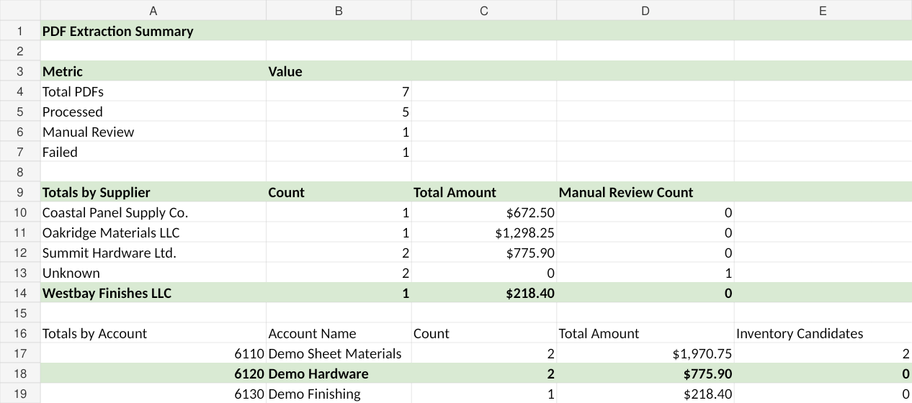

# Purchasing Data Transformation

**A business-led, tech-enabled process improvement case**  
*Independent solution-design engagement · US custom manufacturing · Local automation · Operational data*

> **In brief:** Supplier-document data entry required **at least 16 hours of hands-on work per week**. I mapped the purchasing workflow and designed a local-first PDF automation MVP that converts documents into structured Excel data and directs uncertain cases to human review. In observed use, weekly review and corrections require **no more than 4 hours**. Comparing these defined activities indicates **at least 12 hours per week of repetitive manual effort redirected — approximately a 75% reduction**. The public implementation and its demonstration documents are fully synthetic and separate from the private operational evidence.

| Before: observed weekly baseline | After: observed weekly review/corrections | Hands-on time improvement |
|---|---|---|
| **16+ hours** of supplier-document data entry | **≤4 hours** of review and corrections | **~75% less** active effort; **12+ hours/week** redirected |

*Methodology: conservative comparison of the measured minimum manual-entry workload with the observed maximum post-automation review/correction workload for the corresponding activity. Unattended Python runtime and any additional setup time are excluded from this **hands-on effort** comparison; a full end-to-end elapsed-time metric should include them. This is operational time saved, not a measured monetary ROI.*

## The business problem

For a custom-manufacturing business, supplier invoices and orders arrive in different PDF layouts. Transcribing and organizing them manually uses employee time and makes it harder to consolidate purchasing information needed for downstream material-cost reviews.

The opportunity was not simply to extract text: it was to **replace repetitive entry with structured data and exception-based work**, without imposing a complicated new platform on nontechnical users.

## My role and decisions

I owned the business-to-solution work: understanding the purchasing-to-costing context, defining requirements and controls, coordinating AI-assisted implementation, testing behavior, documenting the workflow, and proposing the next operational steps.

Three decisions shaped the MVP:

- **Local-first processing:** keep supplier files on the user's computer rather than sending them to an outside service.
- **Human review by design:** automatically separate clear cases from uncertain and technically failed documents.
- **Familiar delivery format:** produce organized copies and an Excel workbook instead of requiring users to adopt a new enterprise platform.

AI coding assistance accelerated implementation; business requirements, review criteria and validation remained part of my role.

## The delivered solution

The Windows-based tool batch-processes supplier PDFs, extracts key purchasing details, creates consistent supplier folders and file names, and produces an Excel workbook with summary and detailed views (**34 data/control fields**). Originals remain untouched; each run preserves prior output folders.

The output includes preliminary material-category suggestions for human review. **It does not automatically post to QuickBooks or determine final accounting treatment.**

## See it in action — reproducible public demo

All public PDFs, vendors, invoice values, account codes and workbook entries were **created from scratch as fictional examples**. They are not anonymized originals.

| Synthetic demonstration | Verified result |
|---|---:|
| Total fixture PDFs | 7 |
| Processed automatically | 5 |
| Routed to manual review | 1 |
| Routed to failed (intentionally invalid PDF) | 1 |
| Output data/control fields | 34 |

The demonstration was tested locally and on Windows 11 with Python 3.13. Two consecutive Windows runs produced separate retained output folders. These synthetic results **demonstrate tool behavior, not the company's observed productivity improvement or an industry-wide automation rate**.

**Explore:** [sample files and output](demo/) · [validation evidence](docs/validation-results.md) · [business case](docs/business-case.md)

## Where this could go next

The MVP solves a focused document-handling problem and creates a useful foundation for broader improvement *if the business chooses to invest further*:

**Validated today:** batch extraction → standardized purchasing workbook → supplier filing → exception review  
**Potential next phase:** approved project identifiers → cost-classification review → controlled accounting-ready exports  
**Longer-term opportunities:** inventory material movement, project-cost visibility and management reporting

Those integrations are **proposed future capabilities**, not current features.

## Technical deep dive

**Stack:** Python, pdfplumber, openpyxl, Windows batch files and JSON configuration.

**Try on Windows:** install Python 3, double-click `Install Requirements.bat`, copy the fictional PDFs from `demo/fixtures/` into `input/`, run `Run PDF Extraction.bat`, and open the latest `output/run_.../extraction_report.xlsx`.

**Run tests:** `python -m unittest discover -s tests -v`.

- [Technical design and safeguards](docs/solution-architecture.md)
- [Validation details and scope of evidence](docs/validation-results.md)
- [Business case, decisions and measurement](docs/business-case.md)
- [Limitations and future roadmap](docs/limitations-and-roadmap.md)
- [Privacy and release checklist](docs/privacy-checklist.md)

**Current boundaries:** no OCR for image-only PDFs, no direct accounting integration and no complete inventory management. Supplier and material rules in the public version are illustrative.

**Release state:** Private showcase candidate. The business identity and original documents remain confidential. Public publication still requires final disclosure and licensing decisions.
