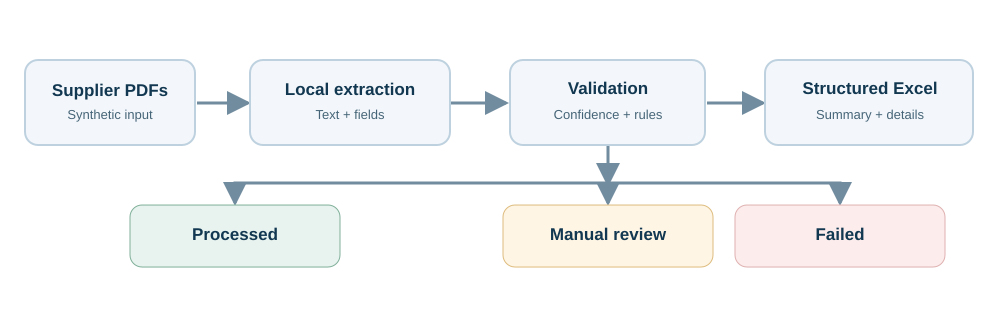

# From Supplier PDFs to Job-Costing-Ready Data

**A business-process automation and solution-design case study**  
*Local-first PDF processing · Human-in-the-loop controls · AI-assisted development · Operational data readiness*


> **Portfolio demonstration.** Every PDF, supplier, document number, account code, and amount in this repository is **fictional**. The case study describes work for a small custom-manufacturing business, but includes no original supplier documents, financial records, or private operating material. This is not an accounting system.

## The business problem

A custom manufacturing company handles supplier invoices and orders in different PDF layouts. File-by-file review, inconsistent naming, and scattered purchasing information create unnecessary administrative work and make information harder to prepare for downstream job-costing and inventory reviews.

**Core question:** How can supplier PDFs become structured, reviewable purchasing information without a costly platform, without uploading documents to external services, and without pretending that every PDF can be extracted reliably?

## My role and approach

**Role:** Business discovery, process mapping, requirements definition, workflow design, AI-assisted development coordination, testing, documentation and operational handoff.

1. Mapped the purchasing-document workflow and its relationship to material costs and project-level reporting.
2. Defined an MVP with local execution, source preservation, standardized Excel output and explicit exception routes.
3. Used AI-assisted coding to accelerate the implementation while maintaining ownership of requirements, review and validation.
4. Tested the workflow on supplier-style documents, recorded limitations and designed a practical next-stage roadmap.

## Solution at a glance



- **Local batch processing:** PDFs are processed on-device using their selectable text layer.
- **34 output fields:** Supplier, document, line-item, amount, classification and processing-control information.
- **Three routes:** `processed`, `manual_review`, and `failed`.
- **Source preservation:** PDFs from `input/` are never modified, renamed or deleted.
- **Structured workbook:** README, Summary, Detailed Extraction, supplier sheets, and Account Rules.
- **Human review:** Low-confidence or image-only documents are not silently accepted as complete.
- **Illustrative material account suggestions:** Not final accounting decisions.
- **No external API or cloud processing:** Runs locally with Python dependencies.

## Reproducible demo results

The included synthetic fixture set contains **7 PDFs**, including an image-only PDF, a PDF embedded in wrapper bytes, and a deliberately invalid PDF.

| Demonstration metric | Result |
|---|---:|
| Synthetic PDF fixtures | 7 |
| Automatically processed | **5** |
| Sent to manual review | **1** |
| Deliberate technical failure | **1** |
| Data/control columns | **34** |

**These are demo-fixture outcomes, not an estimated production automation rate.** See [validation notes](docs/validation-results.md).

## Try the working tool

### Windows — simple workflow

1. Install Python 3 (with `py` or `python` available on the PATH).
2. Double-click `Install Requirements.bat` once.
3. Copy files from `demo/fixtures/` into the root `input/` directory.
4. Double-click `Run PDF Extraction.bat`.
5. Open the new timestamped `output/run_.../extraction_report.xlsx` and inspect `processed/`, `manual_review/`, and `failed/`.

The launcher creates a new run directory instead of deleting previous results. Originals remain under `input/`.

### Cross-platform CLI

```bash
python -m pip install -r requirements.txt
python src/extract_pdf_fields.py \
  --input demo/fixtures \
  --output-root output/demo-run \
  --output extraction_report.xlsx \
  --scan-policy manual_review
```

The CLI does not purge old run directories; for a clean run, use a fresh `--output-root`. The Windows launcher creates fresh run folders automatically.

### Tests

```bash
python -m unittest discover -s tests -v
```

The demo input set and a generated synthetic workbook are also available at [`demo/`](demo/). The included workbook is for review only, not accounting import.

## What this enables—and what it does not yet prove

| Value driver | Capability | Measurement to add |
|---|---|---|
| Administrative efficiency | Batch processing and exception-first review | Minutes per PDF before vs. after |
| Data quality | Standardized extract fields and confidence flags | Required-field accuracy |
| Operational control | Source preservation and explicit review/failure routes | Exception resolution rate |
| Accounting readiness | Material category suggestions and supplier summaries | Share of costs assigned to projects |
| Future inventory readiness | Candidate stock flags | Review accuracy and stock releases |

No measured time savings, production ROI, complete inventory integration, or QuickBooks synchronization are claimed.

## Project documents

- [Business case and ownership](docs/business-case.md)
- [Solution architecture and safe file handling](docs/solution-architecture.md)
- [Demo validation and reproducibility](docs/validation-results.md)
- [Known limitations and future roadmap](docs/limitations-and-roadmap.md)
- [Privacy and release review](docs/privacy-checklist.md)

## Limitations

The current tool reads PDF text layers; **it does not perform OCR**. Supplier aliases and material rules are examples, not verified production master data. Material account and inventory flags are suggestions only. See the full [limitations and roadmap](docs/limitations-and-roadmap.md).

**Technical stack:** Python · pdfplumber · openpyxl · Windows batch · JSON configuration · AI-assisted development.

**Publication status:** Sanitized showcase candidate. Public release should follow privacy, Windows execution and ownership/licensing review. No third-party supplier documents are supplied.
